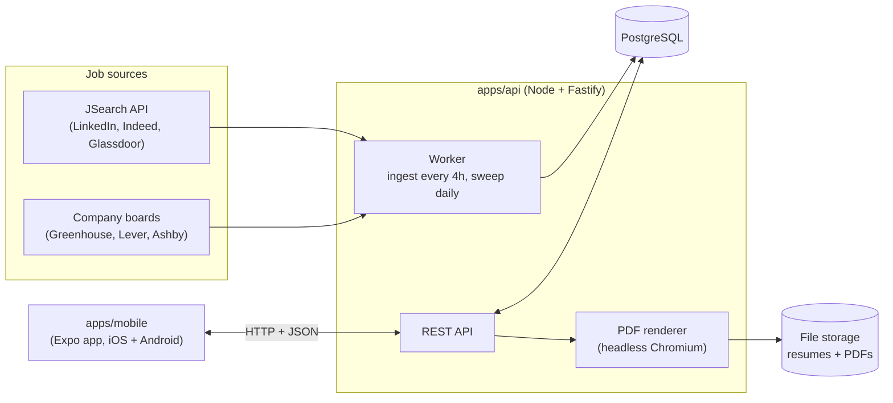
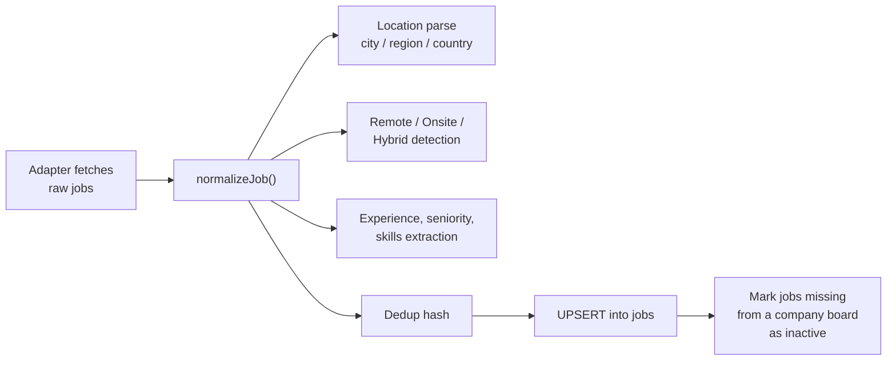
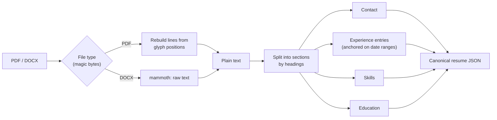

# How JobApp works

This walks through the whole system: what each part does, how data moves between them, and why
it was built that way. File paths are relative to the repo root.

---

## 1. The big picture



There are three moving parts:

1. **The worker** pulls jobs from outside sources on a schedule. It cleans them up (location,
   remote/onsite/hybrid, years of experience, skills) and stores them in Postgres, merging duplicates.
2. **The API** answers the app: search jobs, read and save the profile, upload and parse a resume,
   score a resume against a job, reword a bullet, and render a PDF.
3. **The mobile app** is the user interface. It holds almost no logic of its own: it asks the API
   and shows the answers.

Everything is TypeScript. The API and the app share one package of types and helpers
(`packages/shared`), so a "Job" or a "Resume" means exactly the same thing on both sides.

### Repo layout

```
apps/api/            server, worker, database migrations, tests
  src/adapters/      one file per job source (JSearch, company boards)
  src/ingestion/     cleaning, de-duplication, extraction, stale-link sweeper
  src/resume/        resume parsing, match scoring, bullet tailoring, PDF rendering
  src/routes/        HTTP endpoints (jobs, users, resumes)
  src/db/migrations/ SQL that creates the tables
apps/mobile/         Expo app
  src/app/           one file per screen (Expo Router: the file path is the route)
  src/components/    reusable UI (cards, chips, market picker, editor, ...)
  src/lib/           API client, session, formatting helpers
packages/shared/     types + logic used by both: enums, resume schema, skills dictionary,
                     country/location parser, search query validation
```

---

## 2. The database

Created by `apps/api/src/db/migrations/001_init.sql`. It's plain SQL, so it runs on any
Postgres, including Supabase later.

| Table | What it holds |
|---|---|
| `users` | Profile: name, years of experience, target titles, **work arrangements** (any of remote/onsite/hybrid), and the **job market** (`market_scope` = global / country / city, plus `market_country_code` and `market_city`). Database constraints make sure a country or city market always has its country (and city). |
| `jobs` | One row per unique job: title, company, location split into city/region/country, `work_arrangement`, `min/max_years_experience` and where that number came from (`experience_source`), `seniority_tier`, `core_skills[]`, the description, the apply link, dates, and `is_active`. |
| `user_resumes` | A user's base resume as JSON (`parsed_json`) plus the original uploaded file. |
| `tailored_resumes` | A job-specific copy of the resume made when you export for a job, plus the PDF it produced. |
| `saved_jobs` | Saved/applied tracking (table exists; no screen uses it yet). |
| `ingestion_runs` | A log line for every ingest and sweep: how many jobs were fetched, added, updated and removed. |

Two details make search fast:
- `jobs.search_vector` is a full-text index computed by Postgres from the title (weighted
  highest), the company and skills, and the description (weighted lowest).
- Indexes on `min_years_experience`, `posted_at`, `core_skills`, `(country_code, city)` and
  `work_arrangement` make every filter in the app an index lookup.

---

## 3. Getting jobs in: the ingestion pipeline

Code: `apps/api/src/ingestion/` and `apps/api/src/adapters/`.



### 3.1 Adapters: where jobs come from

Every source implements one small interface, `JobSourceAdapter` (`adapters/types.ts`): "given what
users are looking for, give me raw jobs". Adding a new job board means adding one file.

- **`JSearchAdapter`** calls the JSearch API, which aggregates Google for Jobs (LinkedIn, Indeed,
  Glassdoor, ZipRecruiter, company sites). It's a *search*, so the worker builds queries from
  what users want:
  - it collects every user's target titles and markets (falling back to `DEFAULT_TARGET_TITLES` /
    `DEFAULT_MARKETS` in `.env` when nobody has set any), capped at 8 titles × 6 markets;
  - **Global**: one query for remote jobs and one for the rest; **Country**: "software engineer in
    United Kingdom" with `country=gb`; **City**: "software engineer in London";
  - it's skipped entirely while `JSEARCH_API_KEY` is empty.
- **`AtsDirectAdapter`** reads the public job-board APIs that Greenhouse, Lever and Ashby expose
  for every company using them (`ATS_BOARDS=greenhouse:stripe,lever:spotify,...`). No key is
  needed, and each response is the company's *complete* list of open jobs. That matters for
  freshness (see 3.4).

We never scrape LinkedIn or Indeed pages directly. That breaks constantly and violates their terms.

### 3.2 Cleaning each job: `normalize.ts` and `extract.ts`

Every raw job goes through `normalizeJob()`:

1. **Location → city / region / country** (`parseLocation()` in `packages/shared/src/countries.ts`).
   Job boards write locations every way imaginable: "San Francisco, CA", "London, England, United
   Kingdom", "Remote - US", "US-NYC", "SF, SEA, NYC", "N/A". The parser:
   - splits off multiple locations and keeps the first;
   - strips words like Remote, Hybrid, Office;
   - finds the country from the right-hand end;
   - recognises US state and Canadian province codes, with a rule so that "CA" in "San
     Francisco, CA" means California, not Canada;
   - knows ~90 major cities, so "Dubai" alone resolves to the UAE;
   - expands abbreviations (NYC, SF);
   - throws away junk like "N/A" or "LOCATION".

   City names are made canonical ("New York City" and "NYC" both become "New York"), so filtering
   and grouping match.
2. **Remote / Onsite / Hybrid** (`detectWorkArrangement()`):
   - a field the source states explicitly (Lever's and Ashby's `workplaceType`) wins;
   - otherwise it looks for "hybrid" or "remote" in the title and location;
   - then a remote flag from the source, double-checked against the description because some
     boards flag hybrid jobs as remote;
   - then phrases like "3 days a week in the office";
   - otherwise onsite.
3. **Years of experience**, in this order of trust (stored in `experience_source`):
   - `source`: the board says so (JSearch's `required_experience_in_months`);
   - `heuristic`: regular expressions over the description catch "3+ years", "5–7 years",
     "at least two years", "minimum of 4 years", "4 or more years". To avoid false hits:
     - the sentence must mention experience;
     - sentences about company age, vesting or contracts are ignored;
     - "5–7 years" isn't also read as "7 years";
     - when a posting lists several requirements, the largest minimum is used, because that's
       usually the headline one;
   - `inferred`: nothing stated, so guess from the title (Senior → 5, Intern → 0). The app
     shows these with a "~" so you know it's an estimate.
4. **Seniority**:
   - from the title first: intern/junior → entry; senior/staff → senior;
     head/director/principal/engineering manager → lead. "Product Manager" is not "lead";
   - otherwise from the years.
5. **Skills**: matched against a dictionary of ~110 skills with aliases
   (`packages/shared/src/skills.ts`), e.g. "Postgres" → PostgreSQL, "k8s" → Kubernetes. It handles
   "C++", "C#", ".NET" and "Node.js", and avoids classic false positives: "Go to our site" is not
   the Go language, and a lone "C" or "R" only counts in a list.
6. **Dedup hash**: `SHA-256(company | normalized title | location)`, all lower-cased and trimmed.
   "Normalized title" strips seniority and qualifiers: "Senior Software Engineer (Payments) -
   Remote" → "software engineer". The same job seen on LinkedIn, Indeed and the company site
   collapses into one row.

No AI is used anywhere here. That keeps ingestion free, fast and predictable, and
`experience_source` tells you how much to trust each number.

### 3.3 Saving: the upsert

Each cleaned job is inserted with `INSERT … ON CONFLICT (dedup_hash) DO UPDATE`:

- **New job**: inserted.
- **Already known**:
  - `last_verified_at` is refreshed and the job is re-activated;
  - the longer description and the bigger skills list are kept;
  - an experience number from a stronger source replaces a weaker one, but never the other
    way round;
  - if the job now comes from a company's own board, the board takes over the row (its apply
    link is the most reliable).

Running ingestion twice in a row adds nothing new. It only refreshes timestamps (this was tested).

### 3.4 Keeping jobs fresh

Three mechanisms take dead listings out of the feed:

1. **Board snapshots.** A company board lists *every* open job, so after reading Stripe's board,
   any Stripe job we had that's no longer on it is marked `inactive` (`removed_from_board`).
   A fetch that fails or returns nothing is skipped, so a glitch can't wipe a company.
2. **Daily sweeper** (`sweep.ts`), for search-sourced jobs only (board jobs are covered by 1):
   - jobs posted more than `JOB_MAX_AGE_DAYS` (45) ago expire;
   - jobs not re-seen in 24 h get their link checked. A link is dead on HTTP 404/410, on
     "no longer accepting applications"-style text in the page, or when the site redirects away
     from the job's ID (Greenhouse sends removed jobs to the careers search page).
3. **Schedule** (`worker.ts`): ingest every 4 hours and sweep daily at 03:30. Each task takes a
   Postgres advisory lock, so running two workers can't double-process. No Redis or queue
   server is needed.

---

## 4. Finding jobs: the search API

`GET /api/jobs` (`apps/api/src/routes/jobs.ts`). The query string is validated by a schema in
`packages/shared/src/jobs.ts`: a bad value returns a clear 400, and a country market without a
country is rejected.

| Filter | How it works |
|---|---|
| `q` | Postgres full-text search (`websearch_to_tsquery`, so "react -native" and quoted phrases work) |
| `max_experience=8` | `min_years_experience <= 8`. Jobs with no stated requirement stay visible |
| `work_type=remote,hybrid` | any of the three |
| `market=global` | no location filter |
| `market=country&country=GB` | jobs in the UK, **plus remote jobs that name no country** (open to anyone) |
| `market=city&country=GB&city=London` | **onsite and hybrid jobs in London**, plus remote jobs open to the UK. A remote job's city doesn't matter, its country does |
| `seniority`, `posted_within_days`, `page`, `page_size` | as named |

**Ordering:** newest first. When you search, it orders by text relevance × a freshness factor
that halves roughly every week, so a perfect match from today beats a perfect match from a month ago.

**Match score on every card:**
- when the app sends its user id (`X-User-Id`), the API loads that user's newest resume once
  and scores every job on the page (`quickScore`, section 6);
- without a resume, `matchScore` is `null` and the app hides the ring.

`GET /api/markets` returns the countries and cities that currently have jobs, with counts.
That's what fills the country list and the "London · 76" chips in the market picker.

---

## 5. Reading a resume: upload → JSON

Code: `apps/api/src/resume/extract-text.ts` and `parse.ts`; endpoint `POST /api/resumes/upload`.



1. **File type** is decided by the file's first bytes, not its name (`%PDF-` or a ZIP header
   plus .docx). Anything else gets a clear "Upload a PDF or DOCX" error.
2. **Getting text out:**
   - **DOCX:** `mammoth` extracts the raw text.
   - **PDF:** pdf.js (via `unpdf`) returns text in *drawing order*, which for many resumes puts
     right-aligned dates at the top of the page, detached from their jobs. So we take every
     text fragment's x/y position, group fragments into lines by baseline, sort them left to
     right, and insert " | " wherever there's a big horizontal gap. "Senior Engineer — PayFlow
     ……… March 2022 – Present" comes back as one line again.
   - If there's almost no text (a scanned image), we stop with "This looks like a scanned
     image" rather than guessing.
3. **Sections:** lines like SUMMARY, Work Experience, Technical Skills or Education (and ~20
   variants) start a new section. "Skills: TypeScript, React" on one line works too, and inside
   Skills, "Languages: …" is treated as a category, not a new section.
4. **Contact:**
   - email, phone, LinkedIn and portfolio/GitHub by pattern;
   - name: the first 2–5-word line that looks like a name and not a job title;
   - location: the first header fragment the location parser recognises.
5. **Experience** is anchored on **date ranges**: "Jan 2020 – Present", "03/2019 to 06/2022",
   "2018 – 2019", "Summer 2019 – …". Each date line marks one job.
   - The 1–2 short lines around it hold the title, company and location, in whatever order the
     resume uses. The piece containing a role word (engineer, manager, analyst…) is the title,
     the piece the location parser recognises is the location, and the rest is the company.
   - Bullets are the lines that follow. Wrapped lines are joined back on.
   - Dates are normalised to `YYYY-MM` / "Present".
6. **Skills**: split on commas, bullets and pipes, mapped to canonical names. If there's no
   skills section, they're pulled from the whole text.
7. **Education**: lines with a degree word (B.S., Bachelor, MBA, PhD…) or an institution word
   (University, College, Institute…), grouped into entries, plus the last 4-digit year.

The result is the **canonical resume JSON** (`packages/shared/src/resume.ts`): `contact`,
`summary`, `experience[]` (each with `bullets[]`), `skills[]`, `education[]`. That single shape is
what the parser writes, the phone edits, and the PDF renderer prints.

After upload:
- the API returns `warnings` for anything it couldn't find ("No email found", "Some roles are
  missing a title");
- if the profile's years are still 0, it fills them from the resume. Overlapping jobs are
  merged first, so two concurrent roles don't double-count.

**Quality check that was run:** exporting a resume to PDF and uploading that PDF again gives
back *identical* JSON in every section. Our own PDFs are fully machine-readable.

---

## 6. Scoring a resume against a job

Code: `apps/api/src/resume/match.ts`. Endpoint: `POST /api/jobs/:jobId/match-audit` (the Match
Check card) and `quickScore` (the ring on feed cards).

**Skills (0–100%).**
- Take the job's top 12 skills; the first five count double (they're the most mentioned).
- A skill counts as yours if it's in your skills list *or* appears in your summary or bullets.
- Specific tools imply general skills: PostgreSQL ⇒ SQL, TypeScript ⇒ JavaScript,
  Kubernetes ⇒ Docker, Django ⇒ Python, and so on. Never the reverse.

**Experience (0–100%).** Your years (from merged date ranges) ÷ the job's minimum, capped at
100%. No stated minimum = 100%.

**Title relevance (0–100%).** The share of the job title's meaningful words found in any of
your past role titles or your target titles.
- Seniority and filler words are ignored, and developer = engineer.
- "Backend Software Engineer" vs your "Software Engineer" = 2/3.

**Overall score:**

| Job lists skills? | Formula |
|---|---|
| yes | 55% skills + 25% experience + 20% title |
| no | 65% title + 35% experience |

The second row exists because of a real bug found while testing in the simulator: a job with no
recognisable skills used to score 100% on experience alone, so "Product Marketing Manager"
showed 100% for a backend engineer. Now it scores ~35%.

The audit also returns:
- **matched** and **missing** skills;
- **skills listed but never shown in a bullet** (recruiters notice that);
- the **experience gap** in years;
- **bullets to improve**, ranked by relevance to this job. A bullet is flagged when it:
  - opens weakly ("Responsible for…", "Worked on…", "Assisted with…");
  - has no number (number words like "three" count);
  - is on-topic but names no tools.

---

## 7. "Tailor to this job": honest rewording

Code: `apps/api/src/resume/tailor.ts`. Endpoint: `POST /api/resumes/:id/tailor-bullet`.

The rules engine only changes *wording*, never facts:

| Rule | Example |
|---|---|
| Passive opener → action verb | "Responsible for designing the ledger…" → "Designed the ledger…" |
| Vague opener | "Worked on migrating 14 services…" → "Migrated 14 services…" |
| | "Assisted with on-call…" → "Supported on-call…" |
| Gerund → past tense | "Mentoring three engineers" → "Mentored three engineers" |
| Use the posting's name for a tool you already mention | "…Node.js and Postgres" → "…Node.js and PostgreSQL" (if the job says PostgreSQL) |

Guarantees:
- it never adds a skill, employer, degree, date or number;
- there's a built-in check that throws if a rewrite contains a number the original didn't;
- job skills you don't have come back separately as **"consider adding only if true"**, and the
  phone shows them as suggestions, not edits;
- the phone shows **before / after**, the "after" is editable, and nothing changes until you tap
  **Use this version**.

The engine sits behind a `BulletTailorer` interface, so an AI model (Claude, OpenAI, Gemini) can
be plugged in later for more natural rewrites, with the same rules about facts.

---

## 8. Making the PDF

Code: `apps/api/src/resume/pdf.ts`. Endpoint: `POST /api/resumes/:id/export-pdf`.

1. `renderResumeHtml()` turns the resume JSON into one HTML page. It's deliberately plain, which
   is what applicant-tracking systems (ATS) read best:
   - single column, real text (no images or tables);
   - standard headings (Summary, Experience, Skills, Education);
   - one font, consistent "Mar 2022 – Present" dates.
2. Headless Chromium (Playwright) prints that page to PDF. Paper size is **Letter** for the
   US/Canada (from your contact location) and **A4** everywhere else. One browser is kept
   running and reused, so each export is fast.
3. The PDF is saved under `apps/api/storage/exports/…`. If you exported for a job, or with
   edits, a `tailored_resumes` row records exactly which version went to which job.
4. The API returns:
   - a **signed link** (`/files?key=…&exp=…&sig=…`): an HMAC signature with a 1-hour expiry, so
     only someone holding the link can download it, and only for an hour;
   - a file name like `Sarah_Malik_Airbnb_Resume.pdf`;
   - the job's apply link.

The phone's preview uses `POST /api/resumes/:id/preview-html`, which returns *the same HTML*
Chromium prints. So the preview matches the PDF on both iOS and Android; Android's WebView can't
show PDFs, so previewing the PDF itself wasn't an option.

---

## 9. The mobile app

Code: `apps/mobile/src`. Built with **Expo** (React Native) so one TypeScript codebase produces
the iOS and Android apps.

### 9.1 Navigation

Expo Router turns files into screens:

```
src/app/_layout.tsx        root: data cache, session, theme; decides onboarding vs main app
src/app/onboarding.tsx     Screen 1 (first launch only)
src/app/(tabs)/_layout.tsx native bottom tabs: Jobs · Resume · Profile
src/app/(tabs)/index.tsx   Screen 2: job feed
src/app/(tabs)/resume.tsx  base resume editor (Screen 4 without a job)
src/app/(tabs)/profile.tsx profile (same form as onboarding)
src/app/job/[id].tsx       Screen 3: job detail + match check
src/app/editor.tsx         Screen 4: editor tailored to one job
src/app/export.tsx         Screen 5: preview & export
```

The root layout uses **protected routes**: until onboarding is finished, only the onboarding
screen exists. After that, only the main app does.

### 9.2 Who you are (session)

`src/lib/session.tsx`:
- on first launch the app calls `POST /api/users`, gets an id, and stores it on the device
  (AsyncStorage);
- every request then carries `X-User-Id`. If the server no longer knows that id (database
  reset), the app quietly creates a new one;
- this is an **MVP stand-in for real login**. Replace it with Supabase Auth or similar before
  real users: right now anyone holding a user id could act as that user.

### 9.3 Talking to the API

`src/lib/api.ts` has one function per endpoint.

**Finding the server**, in order:
1. `EXPO_PUBLIC_API_URL` if set (the APK sets `http://localhost:4000`);
2. otherwise, during development, the computer that serves the app's code (Expo's `hostUri`)
   on port 4000. That's why the simulator and a phone on your Wi-Fi find your Mac with no setup.

**Uploads use `XMLHttpRequest`**, not `fetch`. On Android with Expo SDK 58, `fetch` can't attach
a picked file and Expo's file module can't read the picker's copy. Both were found by testing on
your vivo. XHR goes through React Native's original networking, which streams the file from its
URI on both platforms.

**Caching:** TanStack Query handles all server data: loading states, retries, pull-to-refresh,
infinite scroll in the feed, and refetching after edits. For example, after an upload it
refreshes the profile, resume, feed and match checks together.

### 9.4 The screens

1. **Onboarding:**
   - step 1 is target roles, years (stepper), work type, job market and name. Continue stays
     disabled until there's a role and the market is complete;
   - step 2 is the resume upload;
   - if you leave halfway, it reopens with what's already saved.
2. **Job feed:**
   - filters start from your profile: market, work types and "Matches my N yrs";
   - the chips change them for this session only. The market chip opens the same picker as
     the profile;
   - search is debounced (it waits 350 ms after you stop typing) and pages load as you scroll.
3. **Job detail:**
   - badges for work type, experience, seniority, source and age;
   - the Match Check: score ring, verdict, skills/experience split, missing and unproven
     skills, up to three bullets to improve (tap one to open it highlighted in the editor);
   - the full description;
   - **Edit Resume & Apply**.
4. **Editor:**
   - collapsible sections for every part of the resume JSON;
   - opened for a job, it adds a live score at the top (re-checked 0.8 s after you stop
     typing), ✨ Tailor on every bullet and on the summary, and tap-to-add chips for the job's
     missing skills ("only if you have them");
   - your edits stay in that job's copy unless you tap "Also save to my base resume".
5. **Preview & export:**
   - the preview, built from the same HTML as the PDF;
   - the PDF is rendered on the server and downloaded to the phone's cache;
   - **Share / Save** opens the iOS share sheet or Android's share options;
   - **Open PDF** opens the system viewer (Quick Look on iOS);
   - **Apply on company site ↗**.

The app follows the phone's light/dark setting (colours in `src/theme.ts`).

---

## 10. One request end to end: "Edit Resume & Apply"

1. You tap a job in the feed. The app calls `GET /api/jobs/:id` and `POST
   /api/jobs/:id/match-audit` with your resume id, then shows the Match Check.
2. **Edit Resume & Apply** opens `/editor?jobId=…`. The editor copies your base resume into
   local state.
3. You tap ✨ on "Responsible for designing the ledger…". The app sends `POST
   /api/resumes/:id/tailor-bullet` with the job id and the text. The server loads the job's
   skills, applies the rules, checks no new numbers appeared, and returns before/after plus
   "consider if true" skills.
4. You accept. The bullet changes in local state, and 0.8 s later the app re-runs the match
   audit on the *unsaved* draft, so the score updates live.
5. **Preview & export PDF**: the app sends the edited draft to `preview-html` (the preview) and
   to `export-pdf`. The server prints the PDF with Chromium, stores it, records a
   `tailored_resumes` row for this job, and returns a signed link. The phone downloads the file
   and shows Share / Open / Apply.

---

## 11. Running it, auto-start, and the APK

**Development:** see the root README. Short version:
- `npm run api:dev` starts the API;
- `cd apps/mobile && npx expo start`, then open the app on the simulator or a phone with Expo Go.

**Always-on test server (this Mac).** `scripts/mac/install-autostart.sh` installs three macOS
launchd agents that start when you log in and restart if they crash:

| Agent | Runs |
|---|---|
| `com.jobapp.api` | `ensure-postgres.sh`, then the API on port 4000 |
| `com.jobapp.worker` | the ingestion schedule (every 4 h) and the daily sweep |
| `com.jobapp.tunnel` | `ngrok http 4000` on the account's free static domain, once the API answers |

How it fits together:
- Postgres is started by Homebrew's own agent.
- `ensure-postgres.sh` also fixes the "lock file already exists" failure you get after an
  unclean shutdown, when macOS reuses Postgres's old process ID for another program.
- `scripts/mac/status.sh` shows what's up; logs are in `~/Library/Logs/JobApp/`.
- The project must live outside Desktop/Documents/Downloads (it's in `~/Developer/JobApp`),
  because macOS blocks background services from reading those folders.

**Why the tunnel works:**
- the API runs with `trustProxy`, so behind ngrok it sees the public `https://` host and signed
  PDF links point there;
- the app sends `ngrok-skip-browser-warning` on every request, so ngrok's free-plan warning page
  never replaces an API response.

**The APK** (EAS profile `preview` in `apps/mobile/eas.json`):
- the server address comes from the EAS environment variable `EXPO_PUBLIC_API_URL`, stored on
  Expo, not in this public repo. To point it elsewhere, run
  `npx eas-cli env:update --environment preview --name EXPO_PUBLIC_API_URL`, then rebuild with
  `npx eas-cli build -p android --profile preview`;
- testers can install it anywhere, as long as this Mac is awake, logged in, and online;
- for real users, move the API, database and files to a host and point the variable there.

**Security note for the tunnel:**
- anyone with the APK (or the address) can reach the API;
- there's no login yet, and uploads are stored on this Mac (10 MB limit each);
- fine for a small test group. Run `scripts/mac/uninstall-autostart.sh`, or stop the tunnel
  agent, when you're not testing.

## 12. Known limits and sensible next steps

| Area | Today | Next step |
|---|---|---|
| Login | Anonymous id stored on the device | Supabase Auth (email / Google / Apple) |
| Hosting | Your Mac | Deploy API + Postgres + file storage |
| LinkedIn/Indeed coverage | Off until `JSEARCH_API_KEY` is set | Add the key; mind the free quota (~200 requests/month; every title × market costs one per run, so run JSearch less often than every 4 h on the free tier) |
| Rewriting | Rules only (verbs, tool names) | Plug an AI model into `BulletTailorer` |
| Resume parsing | Rules; good on standard layouts | AI fallback for unusual layouts, OCR for scanned PDFs |
| Saved jobs | Table exists, no screen | "Saved / Applied" tab |
| Profile years | Not updated from later uploads | Offer to update when a new resume shows more years |
